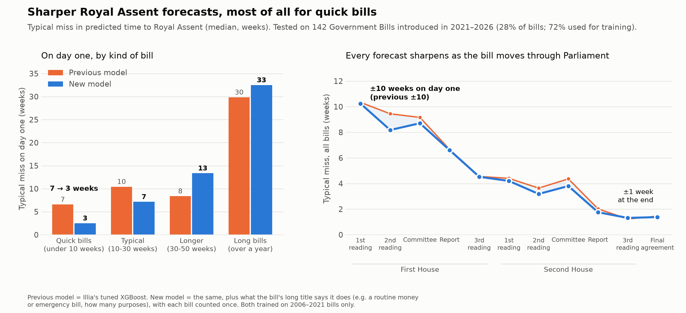

# When will a bill become law? Sharper forecasts for quick bills



## In one minute

- We forecast **how many weeks a Government Bill will take to reach Royal Assent**. The
  forecast is made on the day the bill is introduced, then updated at each stage in
  Parliament.
- The new model is much better at spotting **quick bills**, such as budget, tax and
  emergency bills that pass in days or weeks:
  - on day one, its typical miss for these bills drops from **7 weeks to 3**;
  - for typical bills, the miss drops from **10 weeks to 7**.
- **Long bills** that take over a year are still hard to call on day one, with a typical miss
  of about 30 weeks. The forecast catches up as the bill moves. By the end of its passage, the
  typical miss for any bill is **about 1 week**.
- The biggest remaining gain would come from knowing **how long the bill is** when it's
  introduced. We don't hold that data yet (see "What would help next").

## How we tested it

- **What was predicted:** time from a bill's first reading to Royal Assent, for the 516
  Government Bills that became law.
- **How the bills were split:** by date, so the model is always tested on bills newer than
  the ones it learned from.

| Bills used to | Introduced | Bills | Share |
|---|---|---|---|
| Train the model | 2006 – 2021 | 374 | 72% |
| Test it | 2021 – 2026 | 142 | 28% |

- **What the comparison means:** both models are scored on exactly the same 142 test bills,
  using only what was known on the day of each forecast.
- **Why 72/28 and not exactly 75/25:** the split falls between parliamentary sessions. An
  exact 75/25 would cut through a session, and then the model would learn from bills that
  finished after some test forecasts were made.

## Results

**Typical miss on the day a bill is introduced** (median, in weeks):

| Kind of bill (by how long it really took) | Test bills | Previous model | New model |
|---|---|---|---|
| Quick (under 10 weeks) | 38 | 7 | **3** |
| Typical (10–30 weeks) | 40 | 10 | **7** |
| Longer (30–50 weeks) | 41 | **8** | 13 |
| Long (over a year) | 23 | **30** | 33 |
| **All bills** | 142 | 10 | 10 |

**Typical miss as the bill moves through Parliament (all bills):**

| Forecast made at | New model |
|---|---|
| Introduction | about 10 weeks |
| 2nd reading (first House) | about 8 weeks |
| Report (first House) | about 7 weeks |
| 1st reading in the second House | about 4 weeks |
| Final stages | about 1 week |

The same pattern holds when we train on fewer bills (62% train, 38% test). There, the miss
for quick bills drops from 11 weeks to 6.

## What changed in the model

- **The previous model** is Illia's tuned XGBoost. It uses the bill's stage, timing,
  department, session calendar and title.
- **The new model** keeps all of that and adds:
  - **What the bill says it does,** read from its long title ("A Bill to …"). For example,
    whether it's a routine money bill, an emergency or temporary measure, or sets up a new
    body, and how many separate purposes it lists.
  - **Each bill counting once in training.** Big bills are seen at many more checkpoints,
    so before this the model leaned towards slow bills.

## Limits to be clear about

- **Longer bills are predicted a little worse.** The new model leans faster overall, so for
  bills that take 30–50 weeks or over a year, its day-one miss is a few weeks larger than
  before.
- **Long bills can't be called on day one.** Nothing we know at introduction marks a bill
  that will stall or be carried over. Only about 1 in 10 of these bills falls inside the
  model's 80% range. For all other bills, about 9 in 10 do.
- **Recent sessions are slower than earlier ones,** because of Brexit, COVID and two very
  long sessions. A model that learns mostly from older bills will tend to predict too
  quickly.
- **Settings and data source:** the model settings were tuned on 2006–2019 bills and haven't
  been retuned for this split. The long titles come from a saved copy of the Parliament Bills
  API, not from our database.

## What would help next

1. **Bill length on the day it's introduced** (clauses and pages). In a what-if test using
   each bill's final length, the typical miss on day one fell from **9.5 to 7.4 weeks**, and
   for long bills from **30 to 22 weeks**.
   - That test is optimistic, because bills grow while they're debated, so it can't be used
     for live forecasts.
   - The database already has empty `size_clauses` and `size_pages` columns. Filling them
     from the as-introduced bill when it's published would make this usable.
2. **Retuning the model on the newer training years.**
3. **Honest ranges for big bills,** so the forecast says clearly when a bill could take over
   a year.

## Files

| File | What it is |
|---|---|
| `0_summary_for_stakeholders.png` | The chart above |
| `1_by_stage_for_stakeholders.png` | Average error in days at each stage: new model, previous model and rule of thumb, all bills. Same layout as the v2 stakeholder chart. New model ±53 days on average, previous ±54, rule of thumb ±73 |
| `2_predicted_vs_real_test.png` | Test bills only: predicted (day one) and real weeks to Royal Assent, one line each, bills sorted by real time |
| `metrics.json` | All numbers, including the split and the what-if test |
| `test_predictions.csv` | Every test forecast, for every model version |

To regenerate, run from `backend/`:

```bash
uv run python -m westminster_weather.analysis.remaining_time_tails --75
```

It takes about 20 seconds. It reads the database and the saved long titles, and makes no
calls to external APIs.
