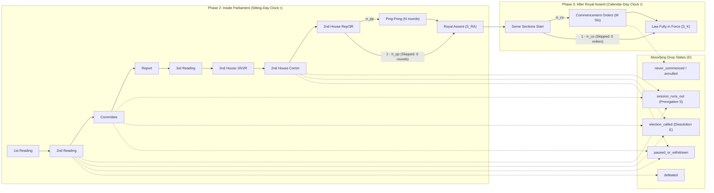

# Westminster Weather: Absorbing Semi-Markov Competing-Risks + Conformalized Quantile Regression (SMP-CQR) Model Proposal

**Status:** Proposal Ready for Review & Implementation  
**Branch:** `docs/semi-markov-cqr-model-proposal`  
**Related Docs:** [`MODEL_SPEC.md`](./MODEL_SPEC.md) · [`BUILD_PLAN.md`](./BUILD_PLAN.md) · [`DATA_CONTRACT.md`](../../DATA_CONTRACT.md) · [`DATA_SCOPE.md`](../../DATA_SCOPE.md)

---

## 0. Executive Summary

Predicting the passage, stage-by-stage dropout risk, Royal Assent date, and commencement date of a UK Government Bill starting from **any mid-process stage** on **any historical or live date `as_of`** is a classic **forward-only, absorbing Semi-Markov Process (SMP) with competing risks and time-varying calendar boundaries**.

A naive single end-to-end regressor (`RemainingDays ~ Features`) fails because:
1. **Rules and duration shapes change radically by stage** (e.g., *Commons 3rd Reading* almost always completes on the same sitting day as *Report Stage*, whereas *Committee Stage* spans weeks of sittings, and *Ping-Pong* or *Commencement Orders* are conditional branches that may be skipped with 0 rounds/orders).
2. **Bills drop out at specific points via competing mechanisms** (session prorogation, general election dissolution, government withdrawal, vote defeat, or uncommenced statutory provisions).
3. **Mid-process conditioning requires survival truncation**: if a bill has already spent $\tau_m^* > 0$ sitting days inside its current stage $S_m$ as of `as_of`, the forecast must condition on survival past $\tau_m^*$ ($T_m > \tau_m^*$) and carry the observed path velocity $H_m$ from stages $S_1, \dots, S_{m-1}$ forward into downstream stages $S_{m+1}, \dots, S_K$.

### Dataset Dimensions in Neon Lakebase Postgres
Per [`DATA_SCOPE.md`](../../DATA_SCOPE.md), our population is strictly **UK Government Bills (`BillType = 1`)** across Parliamentary Sessions 19–40 (2006–2026):
- **$N_{\text{bills}} = 588$ UK Government Bills** (`522` Acts, `26` fell at dissolution, `18` fell at session end, `5` withdrawn, `17` currently in progress).
- **$N_{\text{sittings}} = 10,290$ Parliamentary Stage Sittings** (`stage_sittings` table), yielding **$N_{\text{phase2\_transitions}} \approx 5,200$ completed stage-transition observations** (`(bill_id, model_state)` pairs) and **$\sim 95,000$ `(bill_id, sitting_day)` hazard rows**.
- **$N_{\text{phase3\_events}} = 4,673$ Post-Royal-Assent Events** across **$522$ Acts** (`act_commencements` and `post_royal_assent_events` tables from `legislation.gov.uk`), including `1,522` Commencement Order SIs, `347` Draft SIs, `807` Substantive Laid SIs, and `431` Amending/Repealing instruments, yielding **$N_{\text{phase3\_transitions}} \approx 1,500$ post-Royal-Assent stage transitions**.
- **Combined Stage-Transition Sample Size:** **$N_{\text{transitions}} \approx 6,700$ stage transitions** across Phases 2 and 3.

This proposal synthesizes the **Stage-Wise Competing-Risk Survival GBDT + Semi-Markov Memory + Conditional Monte Carlo + Conformalized Quantile Regression (CQR)** architecture and adapts it specifically to the institutional mechanics of Westminster.

---

## 1. Mathematical Formulation: Clock-Reset Absorbing Semi-Markov Process

### 1.1 State Space & Directed Acyclic Graph (DAG)

Let the legislative pipeline for a UK Government Bill be a forward-only Directed Acyclic Graph (DAG) over transient stages $\mathcal{T} = \{S_1, S_2, \dots, S_{K-1}\}$ and absorbing states $\mathcal{A} = \{S_K\} \cup \mathcal{D}$:



1. **Transient Stages ($\mathcal{T}$)**:
   - **Commons-first Bills** (`originating_house == "Commons"`):
     $$\big(\texttt{commons\_1st\_reading},\; \texttt{commons\_2nd\_reading},\; \texttt{commons\_committee},\; \texttt{commons\_report\_stage},\; \texttt{commons\_3rd\_reading},\; \texttt{lords\_1st\_and\_2nd\_reading},\; \texttt{lords\_committee},\; \texttt{lords\_report\_and\_3rd\_reading},\; [\texttt{ping\_pong}]\big)$$
   - **Lords-first Bills** (`originating_house == "Lords"`):
     $$\big(\texttt{lords\_1st\_and\_2nd\_reading},\; \texttt{lords\_committee},\; \texttt{lords\_report\_and\_3rd\_reading},\; \texttt{commons\_1st\_reading},\; \texttt{commons\_2nd\_reading},\; \texttt{commons\_committee},\; \texttt{commons\_report\_stage},\; \texttt{commons\_3rd\_reading},\; [\texttt{ping\_pong}]\big)$$
   - **Post-Royal-Assent Stages** (`LifecyclePhase.AFTER_ROYAL_ASSENT`):
     $$\big(\texttt{royal\_assent} \to \texttt{some\_sections\_start} \to [\texttt{commencement\_orders}] \to [\texttt{regulations\_drafted}] \to [\texttt{regulations\_laid}] \to \texttt{law\_fully\_in\_force}\big)$$
2. **Absorbing Completion States**:
   - $S_{\text{RA}} = \texttt{royal\_assent}$ (completion of Phase 2: Bill becomes an Act of Parliament).
   - $S_K = \texttt{law\_fully\_in\_force}$ (completion of Phase 3: Act's substantive provisions are commenced).
3. **Absorbing Dropout States ($\mathcal{D} \subset \texttt{StopReason}$)**:
   - Phase 2 Dropouts: $\mathcal{D}_2 = \{\texttt{session\_runs\_out},\; \texttt{election\_called},\; \texttt{paused\_or\_withdrawn},\; \texttt{defeated},\; \texttt{deadlock}\}$.
   - Phase 3 Dropouts: $\mathcal{D}_3 = \{\texttt{never\_commenced},\; \texttt{annulled}\}$.

---

### 1.2 Dual-Clock Time Domain ($\tau$ vs $t$)

A critical property of Westminster is that **Parliament cannot advance a bill during recesses** (summer, Christmas, Easter, party conference recesses, or weekends), whereas **Ministers can sign Commencement Orders and Statutory Instruments on any calendar day**:
- **Phase 2 Clock (House Sitting Days):** For any stage $S_k \in \text{Phase 2}$, sojourn time $\tau_k \in \mathbb{N}_0$ is measured in **sitting days of the active House** (`sitting_days` table). A bill introduced two sitting days before the 6-week summer recess that has its 2nd Reading two sitting days after recess has $\tau_k = 4$ sitting days (not 46 calendar days).
- **Phase 3 Clock (Calendar Days):** For any stage $S_k \in \text{Phase 3}$, sojourn time $\tau_k \in \mathbb{R}_{\ge 0}$ is measured in **calendar days** since Royal Assent.
- **Calendar Mapping Function $\mathcal{C}_h(t_0, \Delta\tau)$:** Given calendar date $t_0$, House $h \in \{\text{Commons}, \text{Lords}, \text{Either}\}$, and sitting-day duration $\Delta\tau$, $\mathcal{C}_h(t_0, \Delta\tau)$ returns the exact calendar date after $\Delta\tau$ sitting days using observed `sitting_days` (for dates $\le \text{as\_of}$) and the ISO-week sitting-day generator (`data/calendar.py`) for future dates $> \text{as\_of}$.

---

### 1.3 Cause-Specific Hazards, Survival, and Cumulative Incidence

When bill $i$ enters stage $S_k$ on calendar date $t_k$, we reset the stage sojourn clock $\tau = 0$ (**Clock-Reset Semi-Markov formulation**). Let:
- $\mathbf{x}_{i,k}$ be the vector of static and stage-entry covariates known at $t_k$,
- $H_{i,k} = \big(\tau_{i,1}, \dots, \tau_{i,k-1},\; t_{\text{elapsed},k},\; v_{i,k-1}\big)$ be the **Semi-Markov path history** accumulated across stages $1 \dots k-1$,
- $d_i(t) = S - t$ be the sitting days remaining until the current Parliamentary Session ends ($S$) or Parliament dissolves ($E$).

For each valid exit destination $j \in \{\text{next}(k)\} \cup \mathcal{D}$, the **cause-specific hazard function** at sojourn duration $\tau$ is:
$$\lambda_{k \to j}(\tau \mid \mathbf{x}_{i,k}, H_{i,k}, d_i) = \lim_{\Delta\tau \to 0} \frac{\mathbb{P}\big(T_k \in [\tau, \tau + \Delta\tau),\; J_k = j \;\big|\; T_k \ge \tau,\; \mathbf{x}_{i,k}, H_{i,k}, d_i\big)}{\Delta\tau}$$
(or its discrete-time equivalent $h_{k \to j}(\tau) = \mathbb{P}(T_k = \tau, J_k = j \mid T_k \ge \tau, \mathbf{x}_{i,k}, H_{i,k}, d_i)$ on the sitting-day grid $\tau \in \{0, 1, 2, \dots\}$).

1. **Total Exit Hazard from Stage $S_k$**:
   $$\lambda_k(\tau \mid \mathbf{x}_{i,k}, H_{i,k}, d_i) = \sum_{j \in \{\text{next}(k)\} \cup \mathcal{D}} \lambda_{k \to j}(\tau \mid \mathbf{x}_{i,k}, H_{i,k}, d_i)$$
2. **Stage Survival Function** (probability of remaining in stage $S_k$ past duration $\tau$):
   $$S_k(\tau \mid \mathbf{x}_{i,k}, H_{i,k}, d_i) = \exp\!\left(-\int_0^\tau \lambda_k(u \mid \mathbf{x}_{i,k}, H_{i,k}, d_i)\,du\right) \quad \text{or} \quad \prod_{u=0}^{\tau-1} \big(1 - h_k(u)\big)$$
3. **Cumulative Incidence Function (CIF)** (probability of exiting stage $S_k$ into state $j$ within duration $\tau$):
   $$F_{k \to j}(\tau \mid \mathbf{x}_{i,k}, H_{i,k}, d_i) = \int_0^\tau S_k(u \mid \mathbf{x}_{i,k}, H_{i,k}, d_i) \cdot \lambda_{k \to j}(u \mid \mathbf{x}_{i,k}, H_{i,k}, d_i)\,du$$

As $\tau \to \infty$, $F_{k \to D}(\infty \mid \mathbf{x}_{i,k}, H_{i,k}, d_i)$ is the exact probability of dropping out while in stage $S_k$, and $F_{k \to \text{next}(k)}(\infty \mid \mathbf{x}_{i,k}, H_{i,k}, d_i)$ is the probability of advancing to the next stage.

---

### 1.4 Structural Decomposition of Competing Risks in Westminster

A critical insight from our Neon database (`bills` table) is **how** the two competing risks ($k \to k+1$ vs $k \to D$) operate in Westminster:
- Of the $588$ Government Bills, **$49$ failed** (`26` `election_called`, `18` `session_runs_out`, `5` `paused_or_withdrawn`, `0` `defeated`).
- **$44$ of the $49$ failures (`89.8%`)** occurred because the **global session clock $S$ (prorogation) or Parliament clock $E$ (dissolution)** expired while the bill was still in stage $S_k$!

Therefore, rather than training a black-box per-stage classifier $P(J_k = D \mid \mathbf{x}_k)$ on only 3–6 failures per stage (which would overfit noise), we decompose the competing risks into their **true structural generators**:
1. **Intrinsic Advancement Time $T_{k \to k+1} \sim S_k^{\text{adv}}(\tau \mid \mathbf{x}_{i,k}, H_{i,k}, d_i)$**: Trained on all $N_{\text{transitions}} \approx 6,700$ stage transitions (treating session-end/dissolution dropouts and `as_of` in-progress stages as **right-censored** at their observed dwell time $\tau_k^*$).
2. **Intrinsic Withdrawal / Defeat Time $T_{k \to \text{withdrawn}} \sim \text{Exponential}(h_w)$ and Vote Defeat Gate $p_{\text{defeat}}$**.
3. **Global Calendar Cutoff $\tau_k^{\max}(S, E) = \min(S, E) - t_k$**: The remaining sitting days in the session/Parliament when stage $S_k$ is entered at date $t_k$.

Then, on any trajectory with session end $S$ and dissolution $E$, the realized stage transition is:
$$T_k = \min\!\big(T_{k \to k+1},\; T_{k \to \text{withdrawn}},\; \tau_k^{\max}(S, E)\big)$$
- If $T_{k \to k+1} \le \min(T_{k \to \text{withdrawn}}, \tau_k^{\max}(S, E))$: the bill **advances** ($J_k = \text{next}(k)$) at duration $\tau_k = T_{k \to k+1}$.
- If $\tau_k^{\max}(S, E)$ binds first:
  - If $E \le S$: the bill **drops out** at stage $S_k$ with `StopReason.ELECTION_CALLED`.
  - If $S < E$ and the bill has **no carry-over motion**: the bill **drops out** at stage $S_k$ with `StopReason.SESSION_RUNS_OUT`.
  - If $S < E$ and `carry_over == 1`: the bill survives prorogation into the next session with a newly drawn session end $S'$!

This structural competing-risks formulation has **two massive advantages**:
1. Our advancement survival model trains on **$N \approx 6,700$ transitions** (with right-censoring), where GBDT survival/AFT models excel.
2. Dropout probabilities $F_{k \to D}(\infty)$ automatically adapt to **how late in the session** the bill is on `as_of`! A bill in Commons Committee with 80 sitting days left in the session has $<3\%$ dropout risk, whereas the exact same bill in Commons Committee with 4 sitting days left before prorogation has $>70\%$ dropout risk.

---

## 2. Comparing Modelling Architectures for Our Dataset ($N_{\text{transitions}} \approx 6,700$)

| Architecture | Accuracy on $N \approx 6,700$ Transitions | Handles Mid-Process Start ($S_m, \tau_m^*$) & Right-Censoring? | Confidence Intervals & Per-Stage Drop Probabilities | Libraries in Stack |
| :--- | :--- | :--- | :--- | :--- |
| **1. Hybrid Stage-Aware GBDT/AFT Competing Risks + Monte Carlo + CQR (Recommended)** | **Highest** — captures non-linear stage rules, Semi-Markov velocity $H_k$, and session-end compression cleanly | **Native** — truncates survival at $T_m > \tau_m^*$, handles right-censored active bills at `as_of`, starts at any $S_m$ | Exact empirical distribution & per-stage drop breakdown via rollout + finite-sample guaranteed coverage via **CQR** | `lightgbm`, `lifelines`, `scikit-learn`, `numpy`, `scipy` |
| **2. Pooled Discrete-Time Logistic Hazard + Monte Carlo (`MODEL_SPEC.md` Baseline)** | **High & Interpretable** — log-linear odds with per-stage duration buckets $f_k(\tau)$ | **Native** — discrete sitting-day grid $\tau \in \{0, 1, \dots\}$ | Calibrated via simulation; misses non-linear interactions between department, velocity $H_k$, and bill size | `scikit-learn` (`LogisticRegression`), `numpy` |
| **3. Two-Stage Hurdle Classifier + Quantile GBDT (Without Calendar Clock)** | **Medium** — struggles with `session_runs_out` / `election_called` if session clock $S - t$ is not simulated | Requires separate per-stage models or censoring approximations | Distribution-free intervals via CQR, but static classifiers overfit on 49 total bill failures | `lightgbm` (`quantile`) |
| **4. Parametric / Spline Multi-State Models (Weibull / Royston-Parmar)** | **Medium** — smooth hazard assumption is violated by same-day ($\tau = 0$) vs multi-week spikes in Parliament | **Native** — analytical $S_k(\tau) / S_k(\tau_m^*)$ | Smooth CIs, but poor fit on bimodal legislative sojourn times | `lifelines` |
| **5. Deep Competing Risks (DeepHit / Dynamic-DeepHit)** | **Low-Medium** — overfits on 588 bills / 6,700 transitions | Native | Discrete probability grid | Not in stack |

---

## 3. Recommended Hybrid Architecture: Detailed Component Specification

To achieve maximum accuracy while preserving full explainability and zero data leakage, we combine **Stage-Aware Competing-Risk Survival / Hazard GBDTs**, **Semi-Markov Path Velocity Features ($H_k$)**, **Structural Session/Election Calendar Clocks**, **Mid-Stage Truncation ($\tau_m^*$)**, and **Conformalized Quantile Regression (CQR)**.

---

### Component A: Stage-Wise & Pooled Survival Transition Engine (`model/hazard.py` & `model/duration.py`)

Because progression rules differ by stage (e.g., $\tau = 0$ same-day transitions are common in `commons_3rd_reading`, whereas `commons_committee` and `commencement_orders` have long right tails), we support a **two-layer transition parameterization**:

#### 1. Zero-Inflation / Same-Day Hurdle ($\tau = 0$ vs $\tau \ge 1$)
Many Parliamentary stages complete on the **exact same sitting day** they are entered ($\tau_k = 0$, e.g., Commons Report Stage $\to$ Commons 3rd Reading, or emergency fast-tracked bills). Continuous AFT models (`log(tau)`) break on $\tau = 0$ unless shifted (`log(tau + 1)`), and shifting distorts the spike at zero.
- **Step A1 (Same-Day Advancement Classifier):**
  A calibrated LightGBM / Logistic classifier predicting the probability of immediate same-day completion ($\tau_k = 0$):
  $$p_{k,0}(\mathbf{x}_{i,k}, H_{i,k}, d_i) = \mathbb{P}(\tau_k = 0 \mid J_k = k+1, \mathbf{x}_{i,k}, H_{i,k}, d_i)$$
- **Step A2 (Strictly Positive Sojourn Survival Model for $\tau_k \ge 1$):**
  Conditional on $\tau_k \ge 1$, we fit both:
  1. **Discrete-Time Gradient Boosted Hazard / Logistic Spline Model (`HazardModel`)**:
     Predicts daily advancement hazard $h_k(\tau \mid \mathbf{x}_{i,k}, H_{i,k}, d_i)$ for $\tau \ge 1$, giving the exact survival curve:
     $$S_k(\tau \mid \mathbf{x}_{i,k}, H_{i,k}, d_i) = \big(1 - p_{k,0}\big) \prod_{u=1}^{\tau} \big(1 - h_k(u \mid \mathbf{x}_{i,k}, H_{i,k}, d_i)\big)$$
  2. **Stage-Stratified Cox / Weibull AFT / Quantile GBDT Ensemble (`DurationQuantileModel`)**:
     Using `lifelines` (`CoxPHFitter` / `WeibullAFTFitter` with right-censoring) and `lightgbm` (`objective="quantile"` across $\alpha \in \{0.05, 0.10, \dots, 0.95\}$ with Inverse-Probability-of-Censoring Weights **IPCW** so right-censored observations are never biased or discarded).

#### Why Pooling with Stage Interactions Beats Disjoint Per-Stage Models
In `lightgbm` and regularized `LogisticRegression`, we include `model_state` (`BillStage`) as a categorical feature alongside `state × tau_bucket` interactions:
- Trees can split on `model_state` whenever a rule is stage-specific (e.g., `commons_committee` vs `commons_3rd_reading`).
- Simultaneously, trees share splits on `velocity_ema`, `committee_whole_house`, `days_to_session_end`, and `department` across all $6,700$ transitions.

---

### Component B: Semi-Markov Memory & Feature Engineering (`model/features.py`)

Every transition at stage $S_k$ receives a feature vector $\Phi_{i,k}(t) = \big[\mathbf{x}_{i,k},\; H_{i,k},\; \mathbf{z}_i(t)\big]$ computed strictly using data dated $\le t$ (verified by automated zero-leakage tests):

#### 1. Static & Stage-Identity Features ($\mathbf{x}_{i,k}$)
| Feature Name | Type | Formula / Definition |
| :--- | :---: | :--- |
| `model_state` | categorical | Current canonical `BillStage` ($S_k$) |
| `state_order` | int | Position of $S_k$ in the bill's chain ($1 \dots 16$) |
| `originating_house_lords` | binary | $1$ if `originating_house == "Lords"`, else $0$ |
| `is_second_house` | binary | $1$ if bill is currently in the non-originating House, else $0$ |
| `department_cat` | categorical | Sponsoring department (top 12 departments + `"Other"`) |
| `introduced_months_into_session` | float | `(introduced_date - session.start_date).days / 30.44` |
| `parliament_age_years` | float | `(t - parliament.first_meeting_date).days / 365.25` |

#### 2. Semi-Markov Memory & Path Velocity Features ($H_{i,k}$)
To propagate information across layers without losing historical signal, we summarize the observed trajectory $S_1, \dots, S_{k-1}$ into scale-free Semi-Markov memory statistics:

1. **Prior-Stage Relative Velocity Ratio ($v_{i,k-1}$)**:
    Let $\overline{\tau}_{j}^{\text{train}}$ be the training-set median sitting days spent in stage $S_j$ (computed strictly on the training split). When bill $i$ completes stage $S_{k-1}$ in $\tau_{i,k-1}$ sitting days, its relative slowness ratio is:
   $$v_{i,k-1} = \frac{\tau_{i,k-1} + 1}{\overline{\tau}_{k-1}^{\text{train}} + 1}$$
   - $v_{i,k-1} < 0.5$ indicates a **fast-tracked / high-priority bill** moving at more than twice normal speed.
   - $v_{i,k-1} > 2.0$ indicates a **bottlenecked / contested bill** bogging down in scrutiny.
2. **Exponentially Weighted Moving Velocity ($V_{i,k}$)**:
   Across all completed stages $1 \dots k-1$, we maintain an exponentially weighted moving average ($\lambda_{\text{ema}} = 0.6$) of log-velocity:
   $$V_{i,k} = \lambda_{\text{ema}} \log(v_{i,k-1}) + (1 - \lambda_{\text{ema}}) V_{i,k-1}, \quad V_{i,1} = 0$$
3. **Cumulative Elapsed Sitting Days ($t_{\text{elapsed},k}$)**:
   $$t_{\text{elapsed},k} = \sum_{j=1}^{k-1} \tau_{i,j}$$
4. **Cumulative Bottleneck Delay ($\Delta_{\text{delay},k}$)**:
   $$\Delta_{\text{delay},k} = \sum_{j=1}^{k-1} \big(\tau_{i,j} - \overline{\tau}_{j}^{\text{train}}\big)$$
5. **Cumulative Sitting Intensity (`n_stage_sittings_cum`)**:
   Total number of distinct stage sitting events (`stage_sittings` rows) accumulated across stages $1 \dots k-1$ (a direct proxy for committee length and bill complexity: e.g., a bill that needed 18 Public Bill Committee sittings in Commons vs 1 sitting).
6. **Procedural Fast-Track & Carry-Over Flags**:
   - `committee_whole_house`: $1$ if `api_stage_id == 49` occurred on or before $t$.
   - `same_day_2r_3r`: $1$ if Commons 2nd and 3rd Reading occurred on the same sitting day.
   - `carry_over`: $1$ if a carry-over motion (`api_stage_id in {18, 19}`) occurred on or before $t$.

#### 3. Dynamic Session-Clock Features ($\mathbf{z}_i(t)$)
- `days_to_session_end` ($d_i(t) = S - t$): Sitting days remaining until session end $S$, bucketed into `{0–5, 6–15, 16–40, 41+}` to capture the pre-prorogation / pre-dissolution **"wash-up" rush**.
- `tau_in_state` ($\tau$): Current sitting days elapsed inside stage $S_k$, bucketed into `{0, 1–5, 6–20, 21–60, 61+}` plus continuous $\log(\tau + 1)$.

---

### Component C: Stochastic Branching Gates (`model/pingpong.py` & `model/commencement.py`)

Most stage transitions in the DAG are deterministic ($S_k \to S_{k+1}$). However, two transitions are **stochastic branches** where a stage is either **Skipped (`0 rounds/orders`)** or **Entered (`N >= 1 rounds/orders`)**:

#### Branch 1: Ping-Pong at the End of the Second House (`ping_pong`)
When a bill finishes `lords_report_and_3rd_reading` (for Commons bills) or `commons_3rd_reading` (for Lords bills):
1. **Ping-Pong Occurrence Probability ($\pi_{\text{pp}}$)**:
   Calibrated logistic / GBDT classifier trained on completed bills:
   $$\pi_{\text{pp}}(\mathbf{x}_i, H_{i,\text{2H}}) = \mathbb{P}\big(\text{Enter } \texttt{ping\_pong} \;\big|\; \mathbf{x}_i,\; V_{i,\text{2H}},\; \texttt{n\_stage\_sittings\_cum},\; \texttt{originating\_house}\big)$$
   - With probability $1 - \pi_{\text{pp}}$, `ping_pong` is marked **`SKIPPED` (`0 rounds`)** and the bill transitions directly to `royal_assent`.
   - With probability $\pi_{\text{pp}}$, the bill enters `ping_pong` with $N_{\text{pp}} = 1 + \text{Poisson}(\lambda_{\text{pp}})$ rounds, where each round adds a sitting-day gap drawn from the empirical ping-pong inter-sitting distribution.

#### Branch 2: Post-Royal-Assent Commencement Route (`act_commencements`)
Once a bill reaches `royal_assent` and `some_sections_start` (which happen on the Royal Assent date):
1. **Commencement Orders Gate ($\pi_{\text{co}}$)**:
   Trained on the **522 Acts** in `act_commencements` (`commencement_orders_count > 0` vs `commencement_orders_count == 0`):
   $$\pi_{\text{co}}(\mathbf{x}_i, H_{i,\text{RA}}) = \mathbb{P}\big(\texttt{commencement\_orders\_count} > 0 \;\big|\; \mathbf{x}_i,\; \texttt{department},\; \texttt{n\_stage\_sittings\_cum}\big)$$
   - With probability $1 - \pi_{\text{co}}$, the Act commences directly via its enactment commencement clause on `royal_assent_date` (`commencement_orders` is marked **`SKIPPED (0 orders)`**, and `law_fully_in_force_date = royal_assent_date`).
   - With probability $\pi_{\text{co}}$, the Act enters `commencement_orders`, and we sample the time from Royal Assent to first and final Commencement Order ($\Delta t_{\text{co},1}, \Delta t_{\text{co,last}}$) using our Phase 3 survival model trained on `act_commencements` and `post_royal_assent_events`.

---

### Component D: Handling Mid-Process & Mid-Stage Conditioning ($S_m, \tau_m^*$)

When generating a forecast on date `as_of` for a bill that is currently in stage $S_m$ and has already spent $\tau_m^* \ge 0$ sitting days in $S_m$ without advancing or dropping out:

1. **Resolved Upstream History ($S_1, \dots, S_{m-1}$)**:
   - For all $k < m$:
     $$\mathbb{P}(\text{Dropped in } S_k \mid \mathcal{F}_{\text{as\_of}}) = 0, \qquad \mathbb{P}(\text{Reached } S_k \mid \mathcal{F}_{\text{as\_of}}) = 1$$
   - The observed durations $\tau_{i,1}, \dots, \tau_{i,m-1}$ are fixed constants that deterministically populate the Semi-Markov memory vector $H_{i,m} = \big(t_{\text{elapsed},m},\; v_{i,m-1},\; V_{i,m},\; \Delta_{\text{delay},m}\big)$.
2. **Exact Conditional Survival Truncation in Active Stage $S_m$ ($\tau_m^* > 0$)**:
   - Because we observe that the bill has survived in stage $S_m$ up to $\tau_m^*$ sitting days ($T_m > \tau_m^*$), Bayes' rule requires truncating stage $S_m$'s survival function at $\tau_m^*$:
     $$S_m(\tau \mid T_m > \tau_m^*, \mathbf{x}_{i,m}, H_{i,m}, d_i) = \frac{S_m(\tau \mid \mathbf{x}_{i,m}, H_{i,m}, d_i)}{S_m(\tau_m^* \mid \mathbf{x}_{i,m}, H_{i,m}, d_i)} \quad \text{for all } \tau > \tau_m^*$$
   - **In Discrete-Time Rollout:** We simply start the simulation clock for stage $S_m$ at $\tau = \tau_m^* + 1$ on the next sitting day after `as_of`!
   - **In Inverse-CDF / Quantile Sampling:** If sampling $T_m$ from a cumulative survival curve $S_m(\tau)$, we draw $u \sim \text{Uniform}\!\big(0,\; S_m(\tau_m^* \mid \mathbf{x}_{i,m}, H_{i,m})\big)$, invert $\tau_m = S_m^{-1}(u)$ (guaranteeing $\tau_m > \tau_m^*$), and set the **remaining time in stage $S_m$** to:
     $$\Delta\tau_m = \tau_m - \tau_m^*$$
3. **Scheduled Future Sittings Override (Live Mode Only)**:
   - If `DatabaseInterface.get_scheduled_sittings(as_of)` contains an already-announced future date $t_{\text{sched}} > \text{as\_of}$ for stage $S_m$ (or $S_{m+1}$), the rollout pins that transition date directly to $t_{\text{sched}}$.

---

### Component E: Forward Monte Carlo Rollout & Conformalized Quantile Regression (CQR) (`model/simulate.py` & `model/conformal.py`)

#### Step 1: Vectorised Forward Monte Carlo Rollout ($M = 5,000$ Trajectories)
For a bill at state $(S_m, \tau_m^*)$ on date `as_of` (using a deterministic seed `hash((bill_id, as_of.toordinal()))` for 100% reproducibility):

1. **Sample Global Calendar Boundaries ($S^{(r)}, E^{(r)}$) for $r = 1 \dots M$**:
   - Let $t_{\text{sess}}$ be the sitting days elapsed in the current session as of `as_of`.
   - Draw remaining session sitting days $S^{(r)} \sim \mathbb{P}(S_{\text{hist}} \mid S_{\text{hist}} > t_{\text{sess}})$ from the empirical distribution of historical completed prorogation sessions in `sessions` (or pin to the announced prorogation date if known by `as_of`).
   - Draw dissolution date $E^{(r)}$ from the Parliament-age dissolution hazard (capped at 5 years from `parliaments.first_meeting_date`).
2. **Roll Forward Stage-by-Stage ($k = m, m+1, \dots, K$)**:
   For each trajectory $r \in \{1, \dots, M\}$:
   - Sample remaining duration $\Delta\tau_k^{(r)}$ in stage $S_k$ (conditioned on $T_k > \tau_m^*$ if $k = m$, else starting at $\tau = 0$).
   - Check competing withdrawal hazard $h_w$ and (at Commons 2R/3R) vote defeat gate $p_{\text{defeat}}$.
   - Advance clock $t^{(r)} \leftarrow t^{(r)} + \Delta\tau_k^{(r)}$.
   - **Check Session / Election Collision**:
     - If $t^{(r)} \ge E^{(r)}$: mark trajectory $r$ as **Dropped at Stage $S_k$** with cause `StopReason.ELECTION_CALLED` and terminate trajectory.
     - If $t^{(r)} \ge S^{(r)}$:
       - If `carry_over == 1`: draw a new session length $S_{\text{next}}^{(r)}$ and continue.
       - Else: mark trajectory $r$ as **Dropped at Stage $S_k$** with cause `StopReason.SESSION_RUNS_OUT` and terminate trajectory.
   - **Propagate Semi-Markov Memory to Stage $S_{k+1}$**:
     - Record stage $S_{k+1}$ entry date $T_{k+1}^{(r)} = \mathcal{C}_h(\text{as\_of}, t^{(r)})$.
     - Update relative velocity $v_{i,k}^{(r)} = \frac{\tau_k^{(r)} + 1}{\overline{\tau}_k^{\text{train}} + 1}$, moving velocity $V_{i,k+1}^{(r)} = \lambda_{\text{ema}}\log(v_{i,k}^{(r)}) + (1-\lambda_{\text{ema}})V_{i,k}^{(r)}$, elapsed sitting days $t_{\text{elapsed},k+1}^{(r)} \leftarrow t_{\text{elapsed},k}^{(r)} + \tau_k^{(r)}$, and remaining session days $d^{(r)} = S^{(r)} - t^{(r)}$.
     - Reset stage dwell time $\tau_{k+1}^* = 0$ and advance $k \leftarrow \text{next}(k)$ (evaluating the Ping-Pong gate $\pi_{\text{pp}}$ at the end of the 2nd House and the Commencement Orders gate $\pi_{\text{co}}$ after Royal Assent).

#### Step 2: Aggregating Raw Monte Carlo Outputs
From the $M = 5,000$ simulated trajectories:
- **Overall Passage Probability**:
  $$\hat{P}(\text{Royal Assent}) = \frac{1}{M} \sum_{r=1}^M \mathbb{I}\!\big(\text{Trajectory } r \text{ reached } S_{\text{RA}}\big)$$
- **Per-Stage Reach & Dropout Probabilities** (for every remaining stage $S_k$, $k \ge m$):
  $$\hat{p}_{\text{reach}}(S_k) = \frac{1}{M} \sum_{r=1}^M \mathbb{I}\!\big(r \text{ entered } S_k\big), \qquad \hat{p}_{\text{fail}}(S_k, c) = \frac{1}{M} \sum_{r=1}^M \mathbb{I}\!\big(r \text{ dropped in } S_k \text{ with cause } c\big)$$
  Note that by construction:
  $$\hat{P}(\text{Royal Assent}) + \sum_{k=m}^{K-1} \sum_{c \in \mathcal{D}} \hat{p}_{\text{fail}}(S_k, c) = 1$$
- **Raw Remaining Time Quantiles** (among the subset of trajectories $\mathcal{M}_{\text{pass}}$ that reached $S_{\text{RA}}$ / $S_K$):
  $$\hat{q}_{\text{low}}^{\text{raw}} = \text{Percentile}_{10}\!\big(\{T_{\text{rem}}^{(r)}\}_{r \in \mathcal{M}_{\text{pass}}}\big), \quad \hat{q}_{50} = \text{Percentile}_{50}\!\big(\{T_{\text{rem}}^{(r)}\}_{r \in \mathcal{M}_{\text{pass}}}\big), \quad \hat{q}_{\text{high}}^{\text{raw}} = \text{Percentile}_{90}\!\big(\{T_{\text{rem}}^{(r)}\}_{r \in \mathcal{M}_{\text{pass}}}\big)$$

#### Step 3: Conformalized Quantile Regression (CQR) Calibration
Sequential Monte Carlo rollouts across multiple stages can slightly under- or over-estimate tail dispersion. To guarantee **distribution-free finite-sample coverage** of the $[p_{10}, p_{90}]$ (80%) and $[p_{05}, p_{95}]$ (90%) prediction intervals:

1. **Chronological Calibration Set ($\mathcal{I}_{\text{cal}}$)**:
   Hold out completed transitions in Parliamentary Sessions `30–34` ($N_{\text{cal}} \approx 900$ stage-to-completion snapshots across starting stages $S_m$).
2. **Relative Scale-Adjusted Conformity Scores ($E_i$)**:
   Because remaining time variance shrinks as a bill gets closer to Royal Assent (Stage 14 has much narrower intervals than Stage 7), we compute **scale-normalized CQR conformity scores** on $\mathcal{I}_{\text{cal}}$:
   $$\hat{\sigma}_i = \max\!\big(\hat{q}_{\text{high},i}^{\text{raw}} - \hat{q}_{\text{low},i}^{\text{raw}},\; 1.0\big)$$
   $$E_i = \max\!\left(\frac{\hat{q}_{\text{low},i}^{\text{raw}} - T_{\text{rem},i}}{\hat{\sigma}_i},\; \frac{T_{\text{rem},i} - \hat{q}_{\text{high},i}^{\text{raw}}}{\hat{\sigma}_i}\right) \quad \text{for } i \in \mathcal{I}_{\text{cal}}$$
3. **Finite-Sample Conformal Quantile ($\hat{\gamma}_{1-\alpha}$)**:
   Let $\hat{\gamma}_{1-\alpha}$ be the $\lceil (1 - \alpha)(N_{\text{cal}} + 1) \rceil / N_{\text{cal}}$ empirical quantile of $\{E_i\}_{i \in \mathcal{I}_{\text{cal}}}$ (computed per stage group or pooled with scale normalization).
4. **Conformalized Prediction Interval**:
   For any new forecast with raw Monte Carlo interval $[\hat{q}_{\text{low}}^{\text{raw}}, \hat{q}_{\text{high}}^{\text{raw}}]$ and width $\hat{\sigma} = \max(\hat{q}_{\text{high}}^{\text{raw}} - \hat{q}_{\text{low}}^{\text{raw}}, 1.0)$:
   $$\big[\hat{L}_{1-\alpha},\; \hat{U}_{1-\alpha}\big] = \Big[\max\!\big(0,\; \hat{q}_{\text{low}}^{\text{raw}} - \hat{\gamma}_{1-\alpha} \hat{\sigma}\big),\;\; \hat{q}_{\text{high}}^{\text{raw}} + \hat{\gamma}_{1-\alpha} \hat{\sigma}\Big]$$
   By Romano, Patterson & Candès (2019), this interval guarantees finite-sample marginal coverage $\mathbb{P}(T_{\text{rem}} \in [\hat{L}_{1-\alpha}, \hat{U}_{1-\alpha}]) \ge 1 - \alpha$ while preserving stage-adaptive interval width!

---

## 4. Implementation Pitfalls & How This Architecture Prevents Them

1. **Pitfall 1: Selection / Survivor Bias from Right-Censoring**
   - *Danger:* Training a duration regressor only on bills that completed Stage $k$ discards bills that were still in Stage $k$ on `as_of` or when prorogation/dissolution struck, biasing duration estimates downward.
   - *Solution:* In Component A, any stage interrupted by `session_runs_out`, `election_called`, or `as_of` is included in the likelihood as **right-censored at $\tau_k^*$** (via discrete-time hazard rows up to $\tau_k^*$ with $y = 0$, and IPCW weights in Quantile GBDT).
2. **Pitfall 2: State Feature Drift During Rollout**
   - *Danger:* If downstream stage models rely on covariates that aren't simulated forward (e.g., future amendment counts in Stage $m+3$), the rollout has missing/stale inputs.
   - *Solution:* Every feature in $\Phi_{i,k}(t)$ is either (a) static at introduction ($\mathbf{x}_i$), (b) a deterministic function of the simulated clock ($d^{(r)}(t) = S^{(r)} - t$, `parliament_age_years`), or (c) updated explicitly by the rollout itself ($t_{\text{elapsed},k}^{(r)}$, $v_{i,k-1}^{(r)}$, $V_{i,k}^{(r)}$).
3. **Pitfall 3: Recess Distortion in Calendar-Day Models**
   - *Danger:* Predicting calendar days directly inside Parliament confuses a 6-week summer recess with a legislative delay.
   - *Solution:* Phase 2 models operate strictly in **House sitting days** $\tau \in \mathbb{N}_0$, and convert back to calendar dates via $\mathcal{C}_h(\text{as\_of}, t^{(r)})$ only when reporting output dates.

---

## 5. Module Layout & Evaluation Plan

### 5.1 Proposed File Structure in `backend/src/westminster_weather/model/`
```text
backend/src/westminster_weather/model/
├── __init__.py
├── cli.py              # CLI: fetch, build, train, evaluate, forecast
├── features.py         # Static x_k, Semi-Markov velocity H_k, and session-clock z_k(t) builder
├── baseline.py         # Baselines B0 (House median) and B1 (Remaining median from state S_m)
├── hazard.py           # Component A: Zero-inflated (tau=0) + Pooled GBDT/Logistic survival hazard
├── branching.py        # Component C: Ping-pong (pi_pp, rounds) & Commencement Order (pi_co) gates
├── failure.py          # Component D: Conditional session-end sampler, dissolution hazard, withdrawal
├── conformal.py        # Component E: Scale-normalized Conformalized Quantile Regression (CQR)
├── simulate.py         # Component E: Vectorised 5,000-path conditional Monte Carlo rollout (tau > tau_m*)
├── forecast.py         # Public forecast_bill(bill_id, as_of) service + FastAPI response builder
└── evaluate.py         # Time-ordered backtest (Train: Sessions 20–29, Cal: 30–34, Test: 35–39)
```

### 5.2 Time-Ordered Backtest & Evaluation Metrics
- **Strict Temporal Split (Zero Future Leakage)**:
  - **Train Split:** Sessions `20–29` (~2006–2017)
  - **Conformal Calibration Split ($\mathcal{I}_{\text{cal}}$):** Sessions `30–34` (~2017–2021)
  - **Out-of-Time Test Split ($\mathcal{I}_{\text{test}}$):** Sessions `35–39` (~2021–2026, excluding in-progress Session `40`)
- **Dual Objective Metrics**:
  1. **Absorption / Dropout Probability Accuracy**:
     - **Brier Score** of $\hat{P}(\text{Royal Assent})$ and $\hat{P}(\text{Royal Assent before session end})$ by starting stage $S_m$.
     - **Time-Dependent Concordance Index ($C$-index)** (`lifelines.utils.concordance_index`) across all test snapshots (including censored/failed bills).
  2. **Time-to-Completion & Confidence Interval Quality**:
     - **MAE (in calendar days)** of $\hat{q}_{50}$ vs Baselines `B0` and `B1` at every stage $S_m$ (verifying that MAE decreases monotonically as the bill advances through stages $S_1 \to S_K$).
     - **Pinball Loss (Quantile Loss)** at $\alpha \in \{0.10, 0.50, 0.90\}$.
     - **Empirical Coverage Rate** of the CQR $[p_{10}, p_{90}]$ interval (target: $80\% \pm 3\%$) and **Mean Interval Width** (in days).
